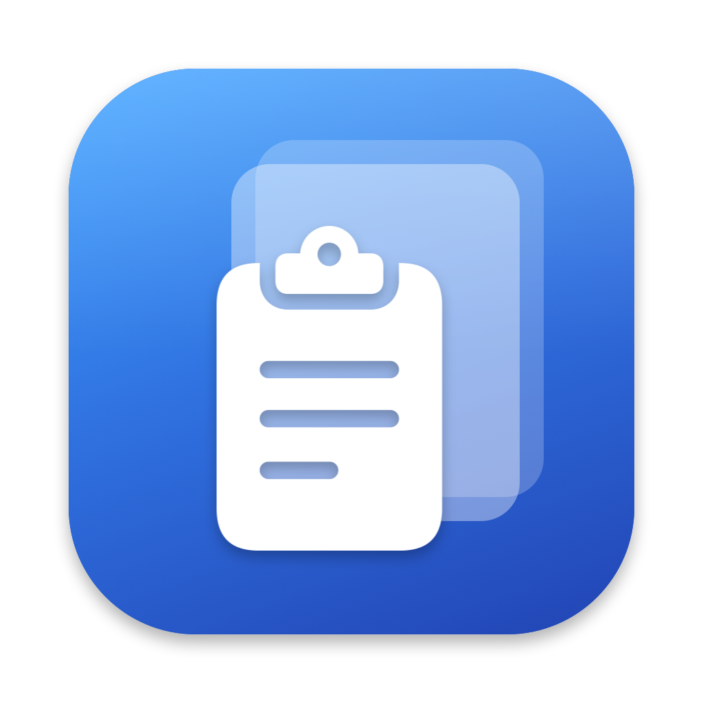
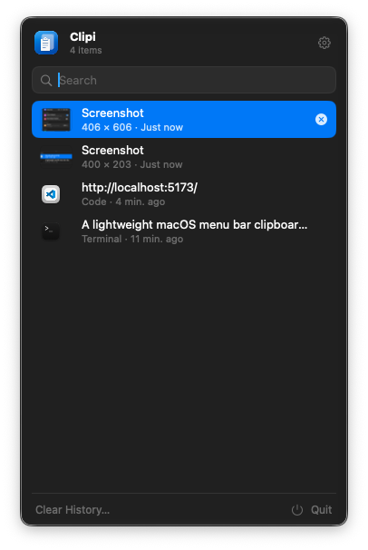
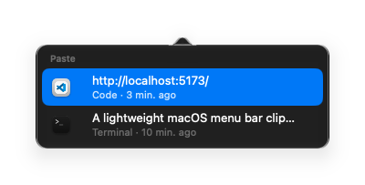
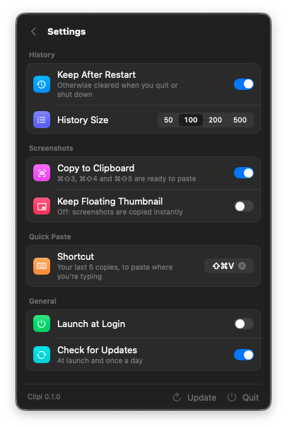

<div align="center">



# Clipi

Clipboard history for the macOS menu bar, with screenshots ready to paste.

[](https://github.com/daveleone/clipi/releases/latest)




</div>

Clipi keeps the last things you copied (text, images, files) one click away in the menu bar. It
also fixes a small annoyance with macOS screenshots: ⌘⇧3, ⌘⇧4 and ⌘⇧5 still save the file where
they always do, but the image is on your clipboard too, so you can paste it straight into a chat
or a document.

## Features

### History

Click the icon in the menu bar to see what you've copied, newest first, with the app each item
came from. Start typing to search. Pick an item with ↑ ↓ and ↩ and it goes back on the clipboard;
the panel closes and the app you were using stays in front, so ⌘V pastes it where you left off.

Press Space to preview the selected item with Quick Look, the same way you would in Finder.

### Quick Paste



Press ⌘⇧V in any app and a small popup with your last five copies opens next to the pointer.
Choose one and Clipi pastes it for you. You can change the shortcut, or turn it off, in Settings.

Pasting directly needs the Accessibility permission. Without it Clipi copies the item and you
press ⌘V yourself.

<br clear="right">

### Screenshots

Screenshots are copied as soon as they're saved and show up in the history like anything else.
By default Clipi turns off the floating thumbnail macOS shows after a capture, because the file
isn't written until the thumbnail goes away. If you'd rather keep it, enable **Keep Floating
Thumbnail** and give Clipi Full Disk Access, and screenshots are still copied right away.

Quitting Clipi, or turning the option off, puts the thumbnail back the way it was.

### Privacy

Clipi skips anything a password manager marks as concealed or temporary, so copied passwords and
one-time codes never end up in the history. The history is stored locally in
`~/Library/Application Support/Clipi`. If you don't want it on disk, turn off **Keep After
Restart** and it's cleared every time you quit or shut down.

### Settings



- Keep the history after a restart, or not
- History size: 50, 100, 200 or 500 items
- Copy screenshots to the clipboard, with or without the floating thumbnail
- Quick Paste shortcut
- Launch at login
- Check for updates at launch and once a day

<br clear="right">

## Keyboard shortcuts

| Key | In the panel |
| --- | --- |
| ↑ ↓ | Move the selection |
| ↩ | Copy the selected item and close |
| Space or ⌘Y | Preview with Quick Look |
| ⌘⌫ | Delete the selected item (with the search box empty) |
| ⌘, | Open Settings |
| ⎋ | Go back, clear the search, then close |

⌘⇧V opens Quick Paste from any app.

## Install

```sh
curl -fsSL https://raw.githubusercontent.com/daveleone/clipi/main/scripts/install.sh | sh
```

The script downloads the [latest release](https://github.com/daveleone/clipi/releases/latest),
moves it to `/Applications` and opens it. You can also grab `Clipi.dmg` from the releases page and
drag the app over yourself.

Clipi updates itself. It checks GitHub at launch and once a day, and when a new version is out a
banner appears in the panel: click **Install & Relaunch** and that's it.

Clipi runs on macOS 14.4 or later. On macOS 26 the panel uses Liquid Glass, like the system menus.

## Build from source

You only need the Swift toolchain that comes with the Command Line Tools; Xcode isn't required.

```sh
./build.sh run       # build and launch build/Clipi.app
./build.sh install   # build, copy to /Applications and launch
```

The app icon is generated at build time from `Resources/icon.png` (1024×1024).

Quick Paste needs the Accessibility permission, and macOS ties that permission to the app's
signature. Run `scripts/make-signing-cert.sh` once to create a local signing certificate:
`build.sh` will sign with it and the permission survives rebuilds. Without it, builds are signed
ad hoc and you have to grant access again after every build.

## Releasing

For local builds the version comes from `CFBundleShortVersionString` in `Resources/Info.plist`.
In CI it's taken from the tag, so publishing a release is just:

```sh
git tag v0.2.0
git push origin v0.2.0
```

The **Build** workflow builds a universal app, packages `Clipi.zip` (the file the updater
downloads) and `Clipi.dmg`, and attaches both to a GitHub release with generated notes.

Releases are signed ad hoc unless these repository secrets are set, in which case they're signed
with a Developer ID and notarized: `MACOS_CERTIFICATE` (a base64 .p12), `MACOS_CERTIFICATE_PASSWORD`,
`APPLE_ID`, `APPLE_APP_PASSWORD` and `APPLE_TEAM_ID`.
